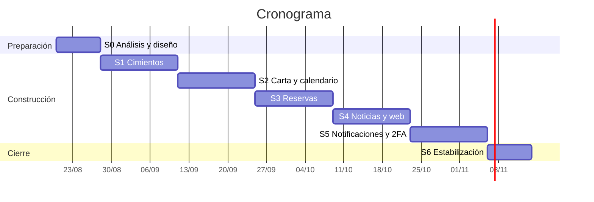

# Plan de sprints — 28 de agosto al 13 de noviembre de 2026

**Ampliación del 22 de octubre, todavía en PR #16:** continuamos desde PR #15 sin merge. Entregamos Mi Pedido, carta original sin fotos, calendario por actividades y dos APK de ensayo; EC-33/29/22 tienen actualización directa en Jira. Añadimos EC-73 (Yeison, En curso, backlog) para gestión de administradores con mínimo de tres activos. No reabrimos el sprint cerrado ni movemos puntos a Listo por código local. Google necesita configuración manual e implementación; EC-22/27 conservan su aceptación pendiente. [Acta y evidencia](Pedido_y_Calendario_2026-10-22.md).

### App móvil — El Encanto Campestre

**Continuación del 22 de octubre:** PR #15 incorpora pagos editables por ADMIN y componentes propios de confirmación/aviso. Pasan 202 pruebas API y 77 móviles; Docker ejecuta la imagen compilada sin montajes y S21 completa login, solicitudes de siete/ocho personas, actualización de estado, cancelación y edición de pagos con datos locales. Recorrimos cinco páginas/cien platos; falta rendimiento representativo de EC-22. Bucket `platos` y carga/lectura/limpieza real aprobados con autorización; falta galería integral de EC-27. EC-35 registra la decisión directamente en Jira y EC-27 su evidencia, sin marcar Listo. No fusionamos ni desplegamos. [Acta vigente](Pagos_Dinamicos_y_QA_2026-10-22.md); Google sigue preparado, no implementado.

**Versión:** 0.5 · **Plan base:** 20 de agosto de 2026 · **Corte de estado:** 16 de octubre de 2026 · Complementa a `Sprint0_Analisis_y_Diseno.md`

**Corte de cierre del 16 de octubre:** integramos PR #11 en `dev`, merge `0245146`, conservando el subconjunto de PR #10 y todos los commits posteriores. El CI de la cabeza final pasó 195 pruebas API sin omisiones y 49 móviles. Registramos en Jira que Yeison asume EC-22/23/24/26/27/28/29/30; EC-25 conserva a Fabián. EC-22 mantiene pendiente la prueba física con 100 platos y EC-27 la validación real de Storage, ambas sin Listo. Los resultados de VPS, estados finales y registro del sprint están en [el acta de cierre](Cierre_Sprint2_2026-10-16.md). Este corte prevalece sobre las notas históricas siguientes.

**Estados:** `[x]` integrado en `dev` y aceptado con evidencia; `[~]` implementado parcialmente o en una rama aún sin integrar/aceptar; `[ ]` pendiente. No contamos código de una rama como entrega cerrada del sprint.

**Revisión del 22 de octubre:** continuamos la entrega de Alex `4d47186` en PR #15 hacia `dev`, sin merge. Revisamos EC-14/33/35/38 y corregimos retorno del login, resumen, retroceso, sincronización y textos. Pasan 62 pruebas móviles y seis unitarias de reglas API; faltan recorrido físico autenticado aislado y datos oficiales de pago/contacto para EC-35. No cambiamos Jira ni EC-22/27. Criterios, commits y encargo manual en [la revisión de Alex](Revision_Alex_2026-10-22.md).

**Corte histórico anterior a PR #11, 16 de octubre:** PR #8 (`b1e0cf1`) conserva integrado el panel de calendario/disponibilidad. En esta rama Yeison implementó la carta EC-22/23/24, la administración EC-26/27, pruebas EC-30 y el flujo de reservas EC-31–40. Pasan build de shared/API, 187 pruebas API con PostgreSQL temporal, 47 pruebas móviles, TypeScript, lint móvil/API y compilación Android. En Docker aplicamos seis migraciones a PostgreSQL desechable y `/api/v1/health` informó base conectada. Además, un smoke HTTP local cubrió registro/login, carta, calendario, franjas, reserva, permisos, aprobación, agenda y cancelación. En el S21 se completó una solicitud de reserva con pedido y su aparición en Mis reservas; como ADMIN se revisó/aprobó, se registró llegada y se cerró la atención. También se probó y revirtió el cambio de disponibilidad general del plato. La prueba encontró que al cambiar de semana el selector conservaba una fecha ya no visible; ahora selecciona una fecha de la semana mostrada y usa chips horizontales, con prueba de regresión y verificación en el S21. La rama `yeison/ajusta-encabezados-y-auth-plan` está publicada y aún no tiene PR integrador. El subconjunto de carta EC-22/23/24 está en la PR #10 hacia `dev`: sigue en borrador, mergeable y con CI de build/pruebas verde, pero sin reviews ni integración; su descripción mantiene pendiente el recorrido en S21 con `restauranteId` real y fotos de dev. Jira no se modificó. Falta la prueba real de fotos con un bucket/clave de Storage y aceptación formal. No usamos Supabase compartido ni la VPS para escrituras. Contrato y resultados actualizados en [Reservas_EC31_EC40.md](Reservas_EC31_EC40.md); evidencia previa del panel en [el acta del celular](evidencias/atencion-celular-2026-10-16/README.md).

**Docker y S21, verificación adicional del 16 de octubre:** ejecutamos también el nuevo paso de CI de contenedor: construyó las imágenes de migración y runtime, aplicó las seis migraciones a PostgreSQL efímero y confirmó `/api/v1/health` con base conectada tanto desde Windows como desde dentro de la imagen. La imagen en ejecución coincidió por ID con la construida, usó `node dist/main.js` y no tenía montajes (`0`). En el S21 quedó instalada una sola copia del paquete `co.encantocampestre.app`; la pantalla Carta obtuvo el plato de prueba «Plato servido por Docker» a través de `localhost:3039` y `adb reverse`. El Compose de QA y su base temporal se retiran al terminar las comprobaciones; no usan volúmenes persistentes ni sustituyen el stack general de la VPS. `scripts/deploy-vps.sh` ahora verifica también imagen, comando y montajes después de esperar el healthcheck. El build Android `release` en Windows no terminó: Ninja/CMake informó `build.ninja still dirty after 100 tries`; por eso esta prueba física se hizo con el APK `debug` y Metro de esta rama, no afirmamos que el artefacto `release` esté validado.

**Recuperación desde el 9 de octubre:** conservamos las fechas originales para hacer visible el atraso. Priorizamos carta/calendario y después reservas antes de abrir más trabajo de Sprint 4. Encargamos a Alex las entregas API+móvil de [Tareas_Alex.md](Tareas_Alex.md); Yeison revisa e integra, y Fabián atiende revisión/correcciones de su calendario ya publicado. No cambiamos retrospectivamente los estimados ni damos por hecha la capacidad para terminar todo.

**Resumen funcional al cierre:** carta, administración y reservas quedaron integradas en `dev` por PR #11. Sprint 2 conserva pendientes EC-22 (fluidez física con 100 platos) y EC-27 (Storage real); sus criterios no se dan por completados. El balance y los estados de Jira están en [el acta de cierre](Cierre_Sprint2_2026-10-16.md). Sprint 3 conserva su aceptación independiente; la expiración programada, recordatorios y notificaciones siguen en Sprint 5. Los cortes anteriores describen comprobaciones históricas, no el estado actual de integración.

**Revisión responsive de pantallas, 16 de octubre:** auditamos las cinco pestañas principales (Carta, Reservas, Noticias, Próximamente y Ajustes), las cuatro vistas secundarias de creación de reserva, administración del menú, administración de reservas y atención, y los modales de detalle de plato y confirmación del calendario. En S21, los encabezados visibles de las cinco pestañas quedan alineados a 128 px (≈43 dp) desde el borde superior, bajo la barra de estado; Noticias ya incorpora el mismo inset y margen de 16 dp que las demás. Las cuatro vistas secundarias reciben el inset con `SafeAreaView` y separan el contenido 16 dp; ambos modales consideran los insets superior e inferior para evitar que contenido o controles queden bajo las barras del sistema. El dispositivo usa 360 × 800 dp, base definida en RNF-11. Para las vistas que requieren autenticación administrativa se hizo auditoría de código; no se alteraron cuentas ni datos remotos para simular su apertura. El selector de fechas usa chips horizontales y al avanzar semana cambia la fecha seleccionada; comprobado en el dispositivo. En Docker aplicamos seis migraciones a PostgreSQL desechable y `/api/v1/health` respondió base conectada. La API y el teléfono usaron únicamente fixtures locales; no leímos ni modificamos `.env` ni tocamos Supabase. El flujo físico principal de reserva y el trabajo administrativo se completó; faltan escenarios límite, Storage real y aceptación del equipo.

Podemos corregir tareas y alcance mediante el procedimiento de [Reglas.md, sección 7](../Reglas.md#7-ajustes-de-alcance-y-sincronización-de-requisitos): corrección en Jira, documentos afectados y recordatorio manual para requisitos en Drive/Word. Cada actividad tiene un responsable único; colaboración no significa dejarla sin asignar.

---

## 1. Calendario

Cinco sprints de dos semanas más uno de cierre de ocho días. Inician viernes y cierran jueves: revisión y retrospectiva el jueves, planificación el viernes.

| Sprint | Inicio     | Cierre     | Foco                                            |
| ------ | ---------- | ---------- | ----------------------------------------------- |
| **0**  | jue 20 ago | jue 27 ago | Análisis, diseño y preparación                  |
| **1**  | vie 28 ago | jue 10 sep | Cimientos: entorno, datos, autenticación e i18n |
| **2**  | vie 11 sep | jue 24 sep | Carta, fotos y calendario de atención           |
| **3**  | vie 25 sep | jue 8 oct  | Reservas: aforo, pedido opcional y aprobación   |
| **4**  | vie 9 oct  | jue 22 oct | Noticias, capa web y deep links                 |
| **5**  | vie 23 oct | jue 5 nov  | Notificaciones, segundo factor y refinamiento   |
| **6**  | vie 6 nov  | vie 13 nov | Estabilización y sustentación                   |

**Capacidad.** Tres integrantes, ~26 h/semana en conjunto → ~52 h por sprint. La velocidad en puntos es desconocida hasta cerrar el Sprint 1; los totales de abajo son hipótesis y conviene recalibrarlos con el dato real.

**Ceremonias.** Planificación el viernes de inicio · sincronización dos veces por semana · revisión y retrospectiva el jueves de cierre · **recorrido de código** el jueves de cierre, donde cada integrante explica un módulo del sprint. Esta última es la preparación directa para los parciales.

---

## 2. Sprint 0 — hasta el 27 de agosto

| Estado | Entregable                                                                                | Responsable |
| :----: | ----------------------------------------------------------------------------------------- | ----------- |
|  [x]   | Documento de análisis y diseño (`Sprint0_Analisis_y_Diseno.md`)                           | Equipo      |
|  [x]   | Modelo de datos y diagrama entidad-relación                                               | Equipo      |
|  [x]   | ADR-001 a ADR-010 aprobados                                                               | Equipo      |
|  [x]   | Registro de decisiones con el cliente (`Decisiones_Pendientes_y_Riesgos.md`)              | Yeison      |
|  [x]   | Fichas de diseño y tokens (`tokens.json`, `tokens.css`)                                   | Alex        |
|  [x]   | Biblioteca de componentes (29 componentes en 7 lotes)                                     | Fabián      |
|  [x]   | Wireframes y 5 pantallas clave de alta fidelidad (`P-01`, `P-02`, `P-07`, `P-09`, `P-22`) | Yeison      |
|  [x]   | Monorepo creado en disco y estructura base de carpetas                                    | Alex        |
|  [x]   | Tablero de Jira configurado con el backlog cargado (`Backlog_Jira.csv`)                   | Yeison      |
|  [ ]   | Entorno de desarrollo nativo verificado en las tres máquinas                              | Equipo      |
|  [x]   | Proyecto de Supabase creado y VPS aprovisionada                                           | Fabián      |

**Cierre.** Cualquier integrante ejecuta `npm run android` sobre un proyecto vacío y se conecta a la API local.

---

## 3. Sprint 1 — Cimientos · 28 ago al 10 sep

**Objetivo.** Monorepo y API repetibles, app móvil base y un usuario capaz de registrarse e iniciar sesión.

|  Estado   | Tarea                                                                                    | Requisitos       |  Pts   | Responsable |
| :-------: | ---------------------------------------------------------------------------------------- | ---------------- | :----: | ----------- |
|    [x]    | Monorepo, convenciones de commits, packages/shared (Zod) y CI mínima                     | RNF-14           |   3    | Yeison      |
|    [x]    | React Native 0.87 bare con Nueva Arquitectura, TypeScript y navegación de 5 tabs         | §13.1            |   8    | Yeison      |
|    [~]    | i18n configurado; falta retirar literales y contenido de muestra de pantallas            | RNF-03, ADR-009  |   3    | Alex        |
|    [x]    | NestJS en contenedor Docker, Swagger en `/api/docs` y manejo centralizado de excepciones | RNF-12, ADR-008  |   5    | Alex        |
|    [x]    | Esquema de Prisma completo (18 entidades) y primera migración en Supabase                | §9               |   8    | Fabián      |
|    [x]    | Datos de siembra (seed): restaurante, zonas, mesas, categorías, platos y calendario      | —                |   3    | Fabián      |
|    [x]    | Registro, inicio, registro móvil, refresco rotatorio y cierre de sesión con Argon2id     | RF-AUT01, 03, 04 |   8    | Alex        |
|    [x]    | Token de refresco en Keystore (`react-native-keychain`) e interceptor de renovación      | RNF-06           |   5    | Yeison      |
|    [x]    | `RolesGuard` y protección de rutas por rol en backend                                    | RNF-08           |   3    | Fabián      |
|    [x]    | Imagen VPS, migraciones, salud remota HTTP/DB y CI/CD dev verificados                    | ADR-008          |   5    | Yeison      |
| **Total** |                                                                                          |                  | **51** |             |

**Evidencia y pendientes del corte:** las salidas SSH recibidas confirman migraciones sin pendientes, API saludable en loopback 8084 y salud HTTPS con PostgreSQL conectado. Después pasó [CI/CD dev, ejecución 37848652598](https://github.com/YeisonMunoz69/Restaurante-Native/actions/runs/37848652598), con la landing integrada en `0e27cb4`. El corte anterior registró 48/51 puntos; no lo presentamos como aceptación definitiva: al revisar pantallas encontramos literales y datos de muestra pendientes de A00/A02. El workspace web sigue siendo un placeholder previsto para Sprint 4; la landing no lo reemplaza. Los estados detallados pesan más que un porcentaje global.

**Corrección del 15 de octubre:** cerramos el criterio de cimientos de monorepo/CI (EC-12) con los workspaces existentes y la ejecución de Actions. La implementación de Next.js pertenece a Sprint 4 y no vuelve a bloquear esa tarea de Sprint 1. Mantenemos i18n parcial (EC-14). La salida SSH de hoy confirma `dev` limpio, el contenedor saludable y PostgreSQL conectado; también verificamos la descarga por Deploy key. Estas comprobaciones no cierran carta ni reservas.

EC-21 no aparece en la lista ni es accesible con nuestra sesión. Registramos la evidencia de despliegue y Deploy key en [EC-72](https://yjmunoz.atlassian.net/browse/EC-72), responsable Yeison, estado Listo, épica EC-1. La verificación actual queda en Sprint 4; no reabrimos ni añadimos retrospectivamente una actividad al sprint cerrado. No le sumamos puntos nuevos: los cinco del despliegue permanecen en la estimación original de Sprint 1.

**Pendiente externo:** confirmar la rotación de Supabase y secretos JWT expuestos; no la damos por hecha. Corregimos la alerta de `proxy-addr` de la API; las alertas móviles/herramientas están descritas en [Flujo_Equipo_Dev.md](Flujo_Equipo_Dev.md). La [guía de despliegue](Despliegue_VPS_Staging.md) distingue preparación inicial y operación diaria. El reparto vigente y sus pruebas de interfaz están en [Tareas_Alex.md](Tareas_Alex.md).

**Riesgos.** La configuración del entorno nativo de Android suele consumir más de lo previsto: conviene resolverla en los primeros tres días y documentarla. Prisma con Supabase requiere distinguir la cadena agrupada de la directa para migraciones.

**Guion para el parcial.** ¿Qué diferencia hay entre el puente clásico y la comunicación vía JSI? ¿Por qué el token de acceso es corto y el de refresco rotatorio? ¿Dónde vive la autorización y por qué no basta con ocultar botones?

**Cierre.** Un usuario se registra, inicia sesión, cierra la aplicación, la reabre y conserva la sesión.

---

## 4. Sprint 2 — Carta y calendario · 11 al 24 sep

**Objetivo.** Que el comensal vea la carta real del próximo día de atención y que el dueño pueda mantenerla.

|  Estado   | Tarea                                                                         | Requisitos         |  Pts   | Responsable |
| :-------: | ----------------------------------------------------------------------------- | ------------------ | :----: | ----------- |
|    [~]    | Carta integrada; aceptación física de 100 platos en backlog (EC-22)                   | RF-MEN01, RF-MEN06 |   8    | Yeison      |
|    [x]    | Pantalla de inicio con los platos del próximo día de atención                 | RF-MEN02           |   5    | Yeison      |
|    [x]    | Detalle de plato con galería de hasta 10 fotos                                | RF-MEN03           |   5    | Yeison      |
|    [x]    | API de menú EC-25: PR #6 integrado, CI/CD y cuatro rutas HTTPS verificados    | RF-MEN01–06        |   5    | Fabián      |
|    [x]    | Administración de categorías y platos en backend y móvil                      | RF-ADM01, 02, 04   |   8    | Yeison      |
|    [~]    | Fotos integradas; Storage real aplazado en backlog (EC-27)    | RF-ADM02, C-7      |   8    | Yeison      |
|    [x]    | Disponibilidad por fecha y carta integrada; cierre técnico EC-28 | RF-ADM03, ADR-010  |   8    | Yeison      |
|    [x]    | Calendario: backend/panel y criterios verificados; cierre técnico EC-29  | RF-ADM06, HU-05    |   8    | Yeison      |
|    [x]    | Pruebas de disponibilidad de plato por fecha                                  | RNF-12             |   3    | Yeison      |
| **Total** |                                                                               |                    | **58** |             |

**Cierre administrativo registrado:** EC Sprint 2 (287) quedó `closed` el 16 de octubre a las 23:43 de Bogotá. Siete historias están Listo: EC-23/24/25/26/28/29/30, 42 de los 58 puntos originales. EC-22 y EC-27 conservan 16 puntos y seguimiento En curso en backlog. No modificamos los estimados ni presentamos todos los puntos como terminados. El registro real no reconstruye la duración histórica del sprint.

**Integración de Sprint 2:** PR #11 incorporó carta, administración y reservas en `0245146`; #10 quedó integrada automáticamente por contener un subconjunto ancestro. La cabeza final pasó 195 pruebas API y 49 móviles, seis migraciones y runtime Docker en CI. Los resultados de despliegue, estados de Jira y pendientes de aceptación se registran en [el acta de cierre](Cierre_Sprint2_2026-10-16.md).

**Responsabilidad del cierre:** registramos en Jira a Yeison como responsable de EC-22/23/24/26/27/28/29/30, conservando a Fabián en EC-25 y la autoría de sus entregas. La reasignación ya está guardada; el reparto histórico se conserva como referencia.

**EC-27 aplazada por acceso externo:** ya está En curso en el backlog del tablero 167, a cargo de Yeison. Conservamos la implementación y los criterios completos de Storage, sin contar sus ocho puntos como entregados. EC-22 también conserva su aceptación física de 100 platos pendiente. En EC-24 registramos que la apertura externa se acepta con EC-47/48 en Sprint 4, donde ya estaba prevista. Pendiente actualizar requisitos en Drive y Word local: RF-ADM02/plan de entrega, Storage aplazado; RF-MEN01/RNF-01, prueba física pendiente; RF-MEN03/RF-INF05, apertura externa en EC-47/48; sección 8, Yeison asume el cierre restante.

**Entrega histórica EC-25 del 15 de octubre (anterior a este cierre):** integramos PR #6 con merge `f8271b9`; CI/CD dev 38840180341 y consultas funcionales HTTPS correctos. Jira EC-25 está Listo (comentario 10039). Precio COP numérico y contratos en [API_Menu_EC25.md](API_Menu_EC25.md), evidencia en [Entrega_EC25.md](Entrega_EC25.md). EC-28 sigue En curso: API/copia confirmada integrada en PR #7 (`19c5d93`), panel Android y aceptación en curso. EC-29 conserva su backend integrado y sigue En curso hasta panel y aceptación. No cerramos las pantallas de Alex ni la administración de Yeison. Pendiente actualizar requisitos en Drive y Word local: RF-ADM03/copia efectiva confirmada, configuración compartida y secciones 8/10.

**Corte de carta y administración:** la implementación cubre categorías, carta paginada, próximo día abierto, consulta por fecha, detalle/galería, administración de categorías/platos, disponibilidad con previsualización y confirmación, procesamiento `sharp`, orden y baja lógica. El contrato público sigue siendo el de EC-25; no exponemos platos inactivos.

**Verificación posterior del 16 de octubre:** configuramos la sede real en el S21 y probamos la carta contra HTTPS dev, detalle con foto y precio, próximo día abierto y aviso al consultar un día cerrado. Registramos capturas y límites en [la evidencia de carta y Docker](evidencias/carta-dev-s21-2026-10-16/README.md). Queda resuelta la falta de `restauranteId` real de los cortes anteriores. La nueva API local dio health correcto pero error de menú por la migración pendiente de `platos.activo`; dejamos el único contenedor local con la API compatible con el esquema actual, y menú HTTP 200. Faltan integración con migraciones, Storage real, aceptación restante y actualización de Jira. El usuario pidió asumir las tareas restantes como Yeison; esa reasignación todavía no se guardó en Jira.

**Si hay que recortar:** búsqueda, filtros, favoritos y caché sin conexión siguen en Sprint 5. No posponemos la integración del calendario que ya está publicado: la necesitamos para validar reservas. Seguimos A00–A06 de la guía de Alex.

**Nota técnica.** Generar aquí la variante de 1200×630 px por debajo de 600 KB evita rehacer el flujo de carga en el Sprint 4.

**Guion para el parcial.** ¿Por qué una lista virtualizada y qué pasa con la memoria sin ella? ¿Qué aporta TanStack Query frente a `useEffect` con `fetch`? ¿Cómo se resuelve la precedencia entre la disponibilidad por fecha y la general?

**Cierre.** El dueño crea un plato con fotos desde el teléfono, lo habilita solo para el domingo siguiente, y el comensal lo ve al consultar esa fecha.

---

## 5. Sprint 3 — Reservas · 25 sep al 8 oct

**Objetivo.** Flujo completo de solicitud, aprobación y operación del servicio. Es el sprint de mayor densidad técnica, aunque bastante más liviano que en la versión anterior del plan gracias al cambio a aforo por franja (ADR-005).

|  Estado   | Tarea                                                                        | Requisitos                 |  Pts   | Responsable |
| :-------: | ---------------------------------------------------------------------------- | -------------------------- | :----: | ----------- |
|    [~]    | Cálculo de franjas a partir del calendario, la duración y la granularidad    | RF-RES01, 02, 17           |   8    | Fabián      |
|    [~]    | Validación de aforo en transacción serializable                              | RF-RES02, ADR-005          |   5    | Fabián      |
|    [~]    | Flujo de reserva en cuatro pasos: fecha, franja, pedido opcional, resumen    | RF-RES03–06                |   13   | Alex        |
|    [~]    | Cálculo del total y generación del ticket copiable                           | RF-RES05, RF-RES18         |   5    | Fabián      |
|    [~]    | Pantalla de solicitud enviada con instrucciones de pago y acción de WhatsApp | RF-RES07                   |   3    | Alex        |
|    [~]    | Bandeja de solicitudes con aprobación y rechazo con motivo                   | RF-RES09, RF-ADM08, 11, 12 |   8    | Yeison      |
|    [~]    | Máquina de estados con validación de transiciones                            | §9.4                       |   5    | Yeison      |
|    [~]    | Mis reservas, detalle y cancelación                                          | RF-RES11, RF-RES12         |   5    | Alex        |
|    [~]    | Agenda del día y marcado de llegada                                          | RF-ADM09, RF-ADM10         |   5    | Yeison      |
|    [~]    | Pruebas de aforo y de transiciones de estado                                 | RNF-12                     |   5    | Yeison      |
| **Total** |                                                                              |                            | **62** |             |

**Situación al 16 de octubre:** implementamos motor de franjas, reglas de duración/anticipación, aforo transaccional, solicitud y líneas con precio congelado, ticket, historial/cancelación, aprobación/rechazo, estado terminal, agenda, llegada, no-show manual y cierre. Shared, API y móvil compilan; pasan las pruebas API con PostgreSQL temporal y 47 pruebas móviles. S21 completó el recorrido reserva → aprobación → llegada → cierre con datos ficticios; el smoke HTTP también verificó permisos y cancelación. No probamos físicamente el límite exacto 59/60 minutos ni una inasistencia después de tolerancia. El trabajo está en la rama indicada, sin merge ni aceptación del equipo. Las responsabilidades originales siguen en la tabla: implementarlo aquí no cambia la autoría ni marca Jira por los compañeros.

**Límites:** no incluimos notificaciones ni recordatorios. Las solicitudes vencen al consultar/escribir tras 12 horas; no hay tarea programada que las expire en segundo plano. El personal registra inasistencia manualmente una vez cumplida la tolerancia configurada. Automatizar vencimiento/inasistencia permanece en Sprint 5. No creamos pasarela de pago ni carga de comprobantes; el pago sigue externo y verificado por ADMIN.

**Riesgos.** La generación asistida tiende a producir verificaciones de aforo en memoria que fallan bajo concurrencia: revisar de forma explícita que la lectura y la inserción ocurran en la misma transacción con aislamiento serializable. Y el paso de pedido debe filtrar por la fecha elegida, no por la del día actual: es un error fácil y conviene cubrirlo con una prueba.

**Guion para el parcial.** ¿Cómo se generan las franjas y cuál es su costo? ¿Por qué una lectura seguida de una escritura permite superar el aforo sin aislamiento adecuado? ¿Por qué las transiciones se validan en el servicio de dominio y no en el controlador?

**Cierre.** Un comensal solicita reserva con pedido, el dueño la aprueba desde su teléfono y copia el ticket con formato legible.

---

## 6. Sprint 4 — Noticias, web y deep links · 9 al 22 oct

**Objetivo.** Que el restaurante pueda comunicar, y que un plato compartido por WhatsApp se vea con su fotografía.

|  Estado   | Tarea                                                                 | Requisitos         |  Pts   | Responsable |
| :-------: | --------------------------------------------------------------------- | ------------------ | :----: | ----------- |
|    [ ]    | Muro de noticias y detalle en la app móvil                            | RF-NOT01, RF-NOT02 |   5    | Yeison      |
|    [ ]    | Administración de noticias: crear, editar, publicar, fijar            | RF-NOT03, RF-NOT04 |   8    | Fabián      |
|    [ ]    | Capa web en Next.js con `/plato/[slug]` renderizado en servidor       | RF-INF04, ADR-004  |   8    | Alex        |
|    [ ]    | Metadatos Open Graph con imagen versionada y verificación             | RF-INF04           |   5    | Alex        |
|    [ ]    | Despliegue de web en Vercel con dominio y HTTPS                       | —                  |   3    | Alex        |
|    [ ]    | Acción de compartir en el detalle del plato                           | RF-INF04           |   3    | Yeison      |
|    [ ]    | Android App Links: `assetlinks.json`, `intent-filter` y verificación  | RF-INF05           |   8    | Yeison      |
|    [ ]    | Enrutamiento de enlaces entrantes hacia el detalle del plato          | RF-INF05           |   5    | Yeison      |
|    [ ]    | Pantalla "Próximamente" con tarjetas de motos y pesca                 | RF-INF06           |   3    | Fabián      |
|    [ ]    | Información del restaurante con mapa MapLibre y contacto por WhatsApp | RF-INF01–03        |   5    | Fabián      |
|    [x]    | Verificación complementaria de CI/CD y Deploy key (EC-72)             | ADR-008            |   —    | Yeison      |
| **Total** |                                                                       |                    | **53** |             |

**Riesgos.** La verificación de App Links depende de que la huella SHA-256 del certificado coincida con `assetlinks.json`; depuración y publicación usan certificados distintos, así que hay que registrar ambas huellas. WhatsApp cachea las vistas previas durante días: para las pruebas conviene usar slugs nuevos en lugar de reutilizar el mismo enlace.

**Guion para el parcial.** ¿Por qué la vista previa exige renderizado en servidor? ¿Qué es un App Link y en qué se diferencia de un esquema de URL personalizado? ¿Qué restricciones de imagen impone WhatsApp y cómo se resolvieron?

**Cierre.** Un plato compartido a un contacto se ve con fotografía y, al pulsarlo, abre la aplicación en su detalle.

---

## 7. Sprint 5 — Notificaciones y refinamiento · 23 oct al 5 nov

**Objetivo.** Cerrar lo transversal y elevar la calidad percibida.

|  Estado   | Tarea                                                                    | Requisitos         |  Pts   | Responsable |
| :-------: | ------------------------------------------------------------------------ | ------------------ | :----: | ----------- |
|    [ ]    | FCM y registro de dispositivo                                            | RF-INF07           |   5    | Alex        |
|    [ ]    | Aviso al dueño de solicitud nueva, por push y correo, con la app cerrada | RF-RES08           |   8    | Alex        |
|    [ ]    | Notificación de aprobación y de rechazo al comensal                      | RF-RES10           |   3    | Alex        |
|    [ ]    | Recordatorio programado antes de la reserva                              | RF-RES14           |   5    | Fabián      |
|    [ ]    | Expiración de solicitudes sin aprobar y marcado de inasistencia          | RF-RES13, RF-RES14 |   5    | Fabián      |
|    [ ]    | Preferencias de notificación por tipo en perfil                          | RF-INF08           |   3    | Yeison      |
|    [ ]    | Segundo factor TOTP y guardia de acciones sensibles                      | RF-AUT06, RF-AUT07 |   8    | Fabián      |
|    [ ]    | Verificación de correo y recuperación de contraseña con Resend           | RF-AUT02, RF-AUT05 |   5    | Alex        |
|    [ ]    | Búsqueda, filtros y favoritos                                            | RF-MEN04, 05, 07   |   8    | Yeison      |
|    [ ]    | Caché de carta sin conexión con MMKV                                     | RF-MEN08           |   3    | Yeison      |
|    [ ]    | Adición de platos a reserva aprobada                                     | RF-RES15           |   5    | Yeison      |
|    [ ]    | Estados vacíos, de carga (esqueleto) y de error en toda la aplicación    | RNF-09             |   5    | Yeison      |
| **Total** |                                                                          |                    | **63** |             |

**Si hay que recortar:** la adición de platos (RF-RES15), la caché sin conexión y los indicadores del dueño (RF-ADM13, ya fuera) son lo primero en diferirse.

**Guion para el parcial.** ¿Cómo llega una notificación desde el servidor hasta la bandeja del dispositivo con la app cerrada? ¿Qué es TOTP y por qué el código cambia cada treinta segundos? ¿Por qué el recordatorio se programa en el servidor y no en el dispositivo?

**Cierre.** Una solicitud nueva llega al teléfono del dueño con la aplicación cerrada; al aprobarla, el comensal recibe la confirmación.

**Cambio de alcance solicitado para el Sprint 5, pendiente de Jira:** Yeison aprobó el 16 de octubre usar Google como único proveedor de inicio de sesión y exigir una sesión antes de entrar a cualquiera de las cinco pestañas o servicios de la app. La pantalla de acceso será la única visible sin sesión; al cerrar sesión se vuelve a ella. Proponemos asignar la validación del token de Google y la emisión de JWT del proyecto a Fabián, y la integración móvil, guardia global y reorganización de Ajustes a Alex. En Ajustes planteamos subpantallas de Perfil, Preferencias, Aplicación, Cuenta y seguridad, e Información/ayuda. No alteramos los puntos ni declaramos estas tareas parte del Sprint 5 hasta reflejarlas en Jira. También debemos revisar allí las tareas de verificación y recuperación de contraseña, que ya no encajan con Google como único proveedor. Pendiente actualizar requisitos en Drive y Word local: RF-AUT01/03/08 y nueva organización de Ajustes.

---

## 8. Sprint 6 — Estabilización y sustentación · 6 al 13 nov

Congelación de funcionalidad nueva desde el 6 de noviembre.

| Estado | Entregable                                                                             | Responsable |
| :----: | -------------------------------------------------------------------------------------- | ----------- |
|  [ ]   | Pruebas de recorrido completo sobre al menos dos dispositivos físicos                  | Yeison      |
|  [ ]   | Corrección de defectos priorizada por severidad                                        | Yeison      |
|  [ ]   | Medición de requisitos no funcionales: tiempos, tamaño del paquete, memoria            | Alex        |
|  [ ]   | APK firmada con instrucciones de instalación, publicada también en la web              | Yeison      |
|  [ ]   | Documentación final: README por proyecto, OpenAPI exportado, diagrama de despliegue    | Fabián      |
|  [ ]   | Manual breve para el comensal y para el dueño                                          | Yeison      |
|  [ ]   | Sesión de validación con el cliente                                                    | Yeison      |
|  [ ]   | Presentación de sustentación y diapositivas                                            | Yeison      |
|  [ ]   | Repaso técnico: cada integrante prepara la explicación de dos módulos que no construyó | Yeison      |

**Cierre.** El dueño instala la aplicación, publica una noticia y aprueba una reserva sin acompañamiento.

---

## 9. Trazabilidad

| Sprint | Requisitos                                                                                                        |
| ------ | ----------------------------------------------------------------------------------------------------------------- |
| 1      | RF-AUT01, 03, 04, 08 · RNF-03, 05, 06, 07, 08, 12, 14                                                             |
| 2      | RF-MEN01, 02, 03, 06 · RF-ADM01, 02, 03, 04, 06 · RNF-01                                                          |
| 3      | RF-RES01–07, 09, 11, 12, 17, 18 · RF-ADM08, 09, 10, 11, 12 · RNF-02                                               |
| 4      | RF-NOT01–04, 06 · RF-INF01–06                                                                                     |
| 5      | RF-AUT02, 05, 06, 07, 09 · RF-MEN04, 05, 07, 08 · RF-RES08, 10, 13, 14, 15 · RF-INF07, 08 · RF-NOT05 · RNF-09, 10 |
| 6      | RNF-01, 02, 11, 13, 15                                                                                            |

Quedan sin sprint asignado, de forma consciente: **RF-RES16** (cambio de plato por otro de igual o mayor precio) y **RF-ADM13** (indicadores), ambos de prioridad opcional. **RF-ADM14** (bitácora) entra si el Sprint 5 lo permite.

---

## 10. Riesgos del semestre

| Riesgo                                            | Prob. | Impacto | Mitigación                                                                                    |
| ------------------------------------------------- | ----- | ------- | --------------------------------------------------------------------------------------------- |
| Los sprints 3 y 5 exceden la capacidad            | Alta  | Alto    | Cada sprint tiene su lista de recorte declarada; aplicarla en planificación, no a mitad       |
| La velocidad real resulta menor que la supuesta   | Alta  | Medio   | Recalibrar tras el Sprint 1 y recortar del alcance opcional, no de la calidad                 |
| El entorno nativo falla en alguna máquina         | Media | Alto    | Documentar el procedimiento en Sprint 0 y mantener la compilación de CI como red de seguridad |
| El equipo no logra explicar el código generado    | Media | Alto    | Recorrido de código al cierre de cada sprint, como criterio bloqueante                        |
| El cliente pide funcionalidades fuera del alcance | Media | Medio   | Alcance acordado en Sprint 0; lo nuevo va al backlog de futuras iteraciones                   |
| La VPS o Supabase quedan inaccesibles             | Baja  | Alto    | Respaldo mensual del esquema y los datos; contenedor reproducible en local                    |
| Pérdida del almacén de claves de firma            | Baja  | Alto    | Resguardarlo desde el Sprint 1 en un gestor compartido                                        |

---

## 11. Trabajo con generación asistida

Dado que la evaluación consiste en explicar el código, conviene:

1. **Generar por unidades pequeñas** — un servicio, un componente o un endpoint por vez.
2. **Escribir primero la firma y la prueba** — acota el resultado y produce material de estudio.
3. **Pedir la justificación junto al código** — el porqué de un enfoque y qué alternativa se descartó alimenta el guion del parcial.
4. **Rotar la propiedad** — que quien explica un módulo en el recorrido no sea quien lo construyó revela con rapidez los puntos flojos.
5. **Desconfiar del código de concurrencia** — es donde la generación asistida produce soluciones que parecen correctas y fallan bajo carga. Revisar con particular atención la validación de aforo del Sprint 3.
6. **Vigilar los literales de texto** — la generación asistida los introduce por defecto. Contradice RNF-03 y es fácil de detectar con una búsqueda antes de cada integración.
