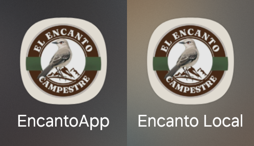
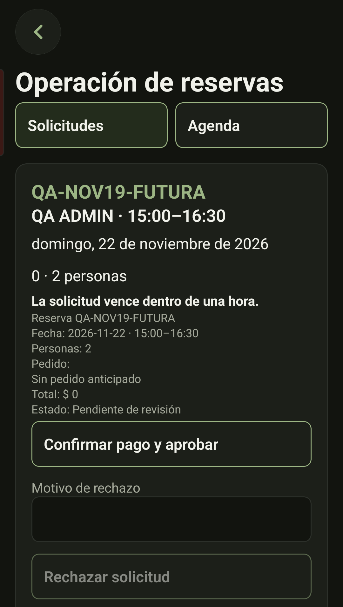

# Reservas y carta en el S21 · 19 de noviembre de 2026

Continuamos el [PR #16](https://github.com/YeisonMunoz69/Restaurante-Native/pull/16). Compilamos las dos variantes debug ARM64 e instalamos sobre las anteriores. Usamos el logo oficial en el lanzador y acortamos la etiqueta de prueba a **Encanto Local** para distinguirla de **EncantoApp** en One UI.

## Qué comprobamos

- **API.** Pasaron 280 pruebas en 27 suites con PostgreSQL desechable y las nueve migraciones. La cobertura local alcanzó 79,27 % de líneas. Verificamos el aforo concurrente con 409 y sin líneas parciales, los 64 pares de estados, la cancelación a 60/59 minutos y las rutas reales de creación y aprobación.
- **Android.** Pasaron 92 pruebas en 28 suites, TypeScript, build y lint de la API y revisión de textos. En el S21 cargamos cinco páginas de 20 platos sintéticos y comprobamos 100 IDs únicos por HTTP local. La regresión móvil confirma que un fallo en una página adicional conserva el contenido y permite reintentar la misma página.
- **Operación.** Desde la variante local vimos una solicitud para el 22 de noviembre con el aviso de vencimiento. Confirmamos su rechazo con motivo y verificamos el estado `RECHAZADA` y el texto exacto en PostgreSQL. El aviso empieza una hora antes del plazo calculado por la API.

## Jira

| Actividad | Estado verificado y evidencia |
| --- | --- |
| [EC-32](https://yjmunoz.atlassian.net/browse/EC-32) y [EC-34](https://yjmunoz.atlassian.net/browse/EC-34) | Listo. Verificamos aforo concurrente, total congelado y ticket sobre la implementación que ya estaba integrada en `dev`. |
| [EC-31](https://yjmunoz.atlassian.net/browse/EC-31) | En curso. Verificamos la generación de franjas y registramos la diferencia entre el criterio antiguo de mínimo entre semana y la decisión B-12. |
| [EC-36](https://yjmunoz.atlassian.net/browse/EC-36) | En curso. Mostramos las solicitudes de todas las fechas y probamos físicamente el aviso y el rechazo. Restan EC-53 y la verificación en dev desplegado. |
| [EC-37](https://yjmunoz.atlassian.net/browse/EC-37), [EC-38](https://yjmunoz.atlassian.net/browse/EC-38), [EC-39](https://yjmunoz.atlassian.net/browse/EC-39) y [EC-40](https://yjmunoz.atlassian.net/browse/EC-40) | En curso. Actualizamos la evidencia de estados, cancelación, agenda y pruebas. Falta integrar la cobertura nueva y completar la aceptación física del borde 60/59 y de la legibilidad de la agenda. |
| [EC-22](https://yjmunoz.atlassian.net/browse/EC-22) | En curso. La paginación pasó con 100 platos sintéticos. Falta medir fluidez con fotos representativas y red móvil. |

Las fotos oficiales y su correspondencia con cada plato siguen pendientes para [EC-27](https://yjmunoz.atlassian.net/browse/EC-27). Hicimos la prueba física con base descartable y cerramos la sesión de QA al finalizar. El PR sigue en revisión hacia `dev`.
